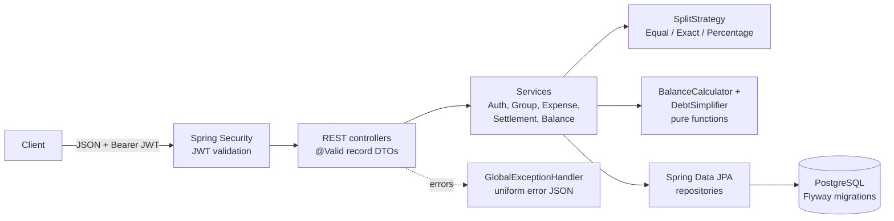

# Splitwise API

A REST API for tracking shared expenses, modelled on the core of Splitwise: users form groups, record
who paid for what, split each expense equally, by exact amounts or by percentage, see who owes whom,
and get a short list of payments that settles everyone up.

It is a backend-only portfolio project (no UI). Interaction is via JSON over HTTP, with interactive
docs in Swagger UI.

## Features

- **Accounts**: register and log in; passwords hashed with BCrypt; stateless JWT (HS256) access tokens.
- **Groups**: create, rename, delete (creator only, and only while empty), add members by email,
  **leave or remove members** - only with a zero balance in the group, so nobody walks away owing money or
  being owed. Members can leave; only the creator removes others; the creator cannot leave.
- **Expenses**: three split strategies, all exact to the cent:
  - `EQUAL`: leftover cents go one each to the lowest user ids (100.00 / 3 = 33.34 + 33.33 + 33.33).
  - `EXACT`: given amounts must add up to the expense amount exactly.
  - `PERCENTAGE`: percentages must add up to 100; rounding uses the largest-remainder method, so the
    shares always add up to the total.
  - Expenses can belong to a group, or sit outside any group (for example, two friends sharing a cab).
- **Edit, delete and restore**: any group member can fix a group expense (as in Splitwise); for non-group
  expenses, anyone involved. Edits use **optimistic locking**: the client sends the `version` it read, and an
  edit based on an older version gets `409` instead of silently overwriting someone else's change. Deletes
  are soft - the expense leaves lists and balances, stays visible by id (`deleted: true`) and can be restored
  (only while everyone in it is still in the group). Settlements recorded by mistake can be undone and
  restored the same way.
- **Balances**: net balance per member of a group, plus each user's overall balance.
- **Friends**: the Splitwise home screen - everyone you have an open balance with ("you owe Bob 40",
  "Carol owes you 30"), with a per-group breakdown and totals that always equal your overall balance. Group
  parts come from the group's simplified debts, the same transfers the group suggests.
- **Settle up with a friend**: one call records the payments that clear every open balance with that friend,
  one settlement per group (so each group's balances stay right) plus one for non-group expenses. Two
  simultaneous settle-ups between the same people never pay twice: both users are locked first.
- **Debt simplification**: turns a group's balances into a short list of "X pays Y amount" transfers.
- **Settle up**: record payments between users; balances and suggested transfers update immediately.
- **Access control**: only members of a group can see or change its data (others get `403`).
- **Safe under concurrent requests**: writes that depend on group membership lock the group row first, so
  "remove a member" and "add an expense for that member" cannot interleave.
- **Consistent errors**: every error returns `{timestamp, status, error, message, path}` with an
  appropriate `400 / 401 / 403 / 404 / 409` status.

## Tech stack

| Area | Choice |
| --- | --- |
| Language / runtime | Java 17 (builds and runs on 17+) |
| Framework | Spring Boot 3.5 (Web, Data JPA, Validation, Security, OAuth2 Resource Server for JWT) |
| Database | PostgreSQL 16, schema managed by Flyway; H2 (PostgreSQL mode) for tests |
| API docs | springdoc-openapi (Swagger UI) |
| Build / CI | Maven (wrapper included), GitHub Actions |
| Packaging | Multi-stage Dockerfile, docker compose (app + Postgres) |

Money is stored as `NUMERIC(19,2)` and handled as `BigDecimal` with scale 2 (`HALF_EVEN` where
rounding is needed). Dates use `LocalDate`, timestamps use `Instant`.

## How debt simplification works

Every expense and settlement changes each person's **net balance**:

- the payer of an expense is credited the full amount, and every participant is debited their share;
- a settlement from A to B credits A and debits B.

Positive means "is owed money", negative means "owes money", and the balances in a group always sum
to zero. Who originally paid whom no longer matters, only these net figures.

The simplifier (`DebtSimplifier`, a pure function) then works greedily:

1. Put creditors and debtors into two max-heaps, ordered by amount (ties broken by user id).
2. Take the largest creditor and the largest debtor. The debtor pays the creditor
   `min(credit, debt)`. At least one of them is now settled.
3. Put whoever still has a remaining balance back into its heap. Repeat until the heaps are empty.

Each step settles at least one person, so `n` people with non-zero balances need at most `n - 1`
transfers. Finding the true minimum number of transfers is NP-hard in general (it reduces to
partitioning people into zero-sum subsets), so this is a heuristic. It is the standard practical
approach and gives the minimum in many common cases, but not in every case.

### Worked example

Alice, Bob and Carol are on a trip:

| Expense | Paid by | Split | Alice | Bob | Carol |
| --- | --- | --- | ---: | ---: | ---: |
| Hotel 300.00 | Alice | equal | +300 - 100 | -100 | -100 |
| Dinner 60.00 | Bob | 50% Alice, 50% Carol | -30 | +60 | -30 |
| **Net** | | | **+170** | **-40** | **-130** |

Simplification: the largest debtor (Carol, 130) pays the largest creditor (Alice, 170), leaving Alice
owed 40; then Bob pays Alice 40.

```
Carol pays Alice 130.00
Bob   pays Alice  40.00
```

If Carol then records a settlement of 130 to Alice, the only remaining suggestion is
`Bob pays Alice 40.00`. This exact scenario is covered by the integration test
`ApiIntegrationTest.groupExpenseBalanceSettleFlow`.

## Architecture



Package layout (`com.splitwise`):

| Package | Responsibility |
| --- | --- |
| `web`, `web.dto`, `web.error` | Controllers, request/response records, exception-to-JSON mapping |
| `service` | Use cases, transactions and access checks |
| `split` | `SplitStrategy` interface and its three implementations |
| `balance` | `BalanceCalculator` and `DebtSimplifier` (no Spring, no I/O) |
| `domain` | JPA entities and money conventions |
| `repository` | Spring Data repositories |
| `security`, `config` | JWT issuing/validation, security filter chain, OpenAPI |

Design notes:

- Balances are **derived on read** from expenses and settlements, never stored, so they cannot drift
  out of sync. This is simple and correct; for very large groups a cached or incremental balance
  table would be the next step.
- `addExpense` runs in one transaction and checks access, split arithmetic and membership **before**
  anything is written.
- The split and simplification logic has no framework dependencies, which keeps it easy to unit-test.

## Running it

### With Docker Compose (app + PostgreSQL)

```bash
cp .env.example .env      # then set DB_PASSWORD and JWT_SECRET (at least 32 bytes)
docker compose up --build
```

The API listens on `http://localhost:8080` and Swagger UI is at
`http://localhost:8080/swagger-ui.html`.

### Locally

You need JDK 17+ and a running PostgreSQL with an empty `splitwise` database. Flyway creates the
tables on startup.

```bash
export DB_URL=jdbc:postgresql://localhost:5432/splitwise
export DB_USERNAME=postgres
export DB_PASSWORD=your-password
export JWT_SECRET=$(openssl rand -base64 48)
./mvnw spring-boot:run
```

| Variable | Required | Default |
| --- | --- | --- |
| `DB_URL` | no | `jdbc:postgresql://localhost:5432/splitwise` |
| `DB_USERNAME` | no | `postgres` |
| `DB_PASSWORD` | yes | (none) |
| `JWT_SECRET` | yes, at least 32 bytes | (none); the app refuses to start without it |
| `JWT_EXPIRATION` | no | `PT1H` |

## API overview

All endpoints except register, login, the API docs and `/actuator/health` need
`Authorization: Bearer <token>`.

| Method | Path | Description |
| --- | --- | --- |
| POST | `/api/auth/register` | Create an account |
| POST | `/api/auth/login` | Get an access token |
| GET | `/api/users/me` | Current user |
| GET | `/api/users/me/expenses` | Expenses I paid for or share in |
| GET | `/api/users/me/settlements` | Settlements I paid or received |
| GET | `/api/users/me/balance` | My overall net balance |
| GET | `/api/users/me/friends` | Everyone I have an open balance with, per group, plus totals |
| GET | `/api/users/me/friends/{userId}` | My balance with one friend, per group |
| POST | `/api/users/me/friends/{userId}/settle-up` | Record the payments that settle everything with a friend |
| POST | `/api/groups` | Create a group (caller becomes a member) |
| GET | `/api/groups` | My groups |
| GET / PUT / DELETE | `/api/groups/{id}` | Get, rename, delete a group |
| POST | `/api/groups/{id}/members` | Add a member by email |
| GET | `/api/groups/{id}/expenses` | Group expenses |
| GET | `/api/groups/{id}/settlements` | Group settlements |
| GET | `/api/groups/{id}/balances` | Net balance per member |
| GET | `/api/groups/{id}/debts/simplified` | Suggested transfers to settle the group |
| POST | `/api/expenses` | Record an expense |
| GET | `/api/expenses/{id}` | One expense (also a deleted one, flagged `deleted: true`) |
| PUT | `/api/expenses/{id}` | Edit an expense; body as for create (without `groupId`) plus `version` |
| DELETE | `/api/expenses/{id}` | Delete (soft; idempotent) |
| POST | `/api/expenses/{id}/restore` | Restore a deleted expense |
| POST | `/api/settlements` | Record a payment (settle up) |
| GET / DELETE | `/api/settlements/{id}` | Get, or undo, a settlement |
| POST | `/api/settlements/{id}/restore` | Restore an undone settlement |
| DELETE | `/api/groups/{id}/members/{userId}` | Remove a member (creator) or leave (your own id); balance must be zero |

Example session:

```bash
curl -s -X POST localhost:8080/api/auth/register -H 'Content-Type: application/json' \
  -d '{"name":"Alice","email":"alice@example.com","password":"password123"}'

TOKEN=$(curl -s -X POST localhost:8080/api/auth/login -H 'Content-Type: application/json' \
  -d '{"email":"alice@example.com","password":"password123"}' | jq -r .accessToken)

curl -s -X POST localhost:8080/api/groups -H "Authorization: Bearer $TOKEN" \
  -H 'Content-Type: application/json' -d '{"name":"Goa trip"}'

curl -s -X POST localhost:8080/api/expenses -H "Authorization: Bearer $TOKEN" \
  -H 'Content-Type: application/json' -d '{
    "description": "Dinner", "amount": 60.00, "paidById": 1, "groupId": 1,
    "splitType": "PERCENTAGE",
    "shares": [{"userId": 1, "value": 50}, {"userId": 2, "value": 50}]
  }'
```

For `EQUAL` splits the `value` of each share is ignored; for `EXACT` it is the amount owed; for
`PERCENTAGE` it is the percentage. `currency` is optional and defaults to `INR`. Only a single
currency is supported for now.

Error example:

```json
{
  "timestamp": "2026-10-11T10:15:30.123Z",
  "status": 400,
  "error": "Bad Request",
  "message": "Exact shares add up to 90.00 but the expense amount is 100.00",
  "path": "/api/expenses"
}
```

## Testing

```bash
./mvnw verify
```

Tests need no database: the `test` profile runs the same Flyway migration on in-memory H2 in
PostgreSQL mode.

- **Unit tests**: each split strategy (including rounding edge cases and randomised checks that
  shares always add up to the total), `DebtSimplifier` (settled groups, chains, cycles, many users,
  at most `n - 1` transfers, determinism), `BalanceService` and JWT configuration.
- **Integration tests** (MockMvc, full Spring context): register/login, auth errors, creating
  groups and adding members, all three split types, balances, simplified debts, settlements,
  `403` for non-members, `404`, `409` and validation errors.
- **Expense life cycle** (`ExpenseLifecycleIntegrationTest`): edits change balances, shares updated in place,
  stale versions rejected, invalid edits change nothing, delete / restore and their effect on lists and
  balances, restore refused once a participant has left.
- **Membership and settlements** (`MembershipAndSettlementIntegrationTest`): leaving only at a zero balance,
  creator rules, re-adding a former member, undoing and restoring settlements, access rules.
- **Property-based tests** (jqwik, `FriendBalanceCalculatorPropertyTest`): thousands of random ledgers
  (up to 6 people, groups and non-group, expenses and settlements) check that friend balances add up to the
  overall balance, that A's balance with B is exactly minus B's with A, that settling every bucket leaves
  nothing, and that amounts are never zero or fractional cents. A failing case is shrunk to a minimal example.
- **Friends** (`FriendBalanceIntegrationTest`, `FriendSettleUpConcurrencyTest`): the friends screen, per-group
  breakdown, settle-up per group, deleted expenses ignored, strangers rejected, and simultaneous settle-ups
  paying only once (also without any group, where only the user lock protects; checked by removing it).
- **Concurrency** (`ConcurrentEditsIntegrationTest`): four simultaneous edits of the same version give exactly
  one success; a member leaving while an expense for them is added never ends with both succeeding. Both tests
  were checked against the code with the safeguard removed (they fail: lost updates, and a member leaving while
  owing money).

GitHub Actions runs `./mvnw -B verify` on every push to `main` and on pull requests, twice: once on H2
and once against a real PostgreSQL 16 service container.

## Roadmap

- Pagination and filtering for expense and settlement lists
- Activity feed / audit trail of who changed what
- Multiple currencies with per-group base currency
- Refresh tokens and rate limiting on the auth endpoints
- Testcontainers-based tests against a real PostgreSQL
- Recurring expenses and expense categories (present in an earlier prototype, not yet rebuilt)
