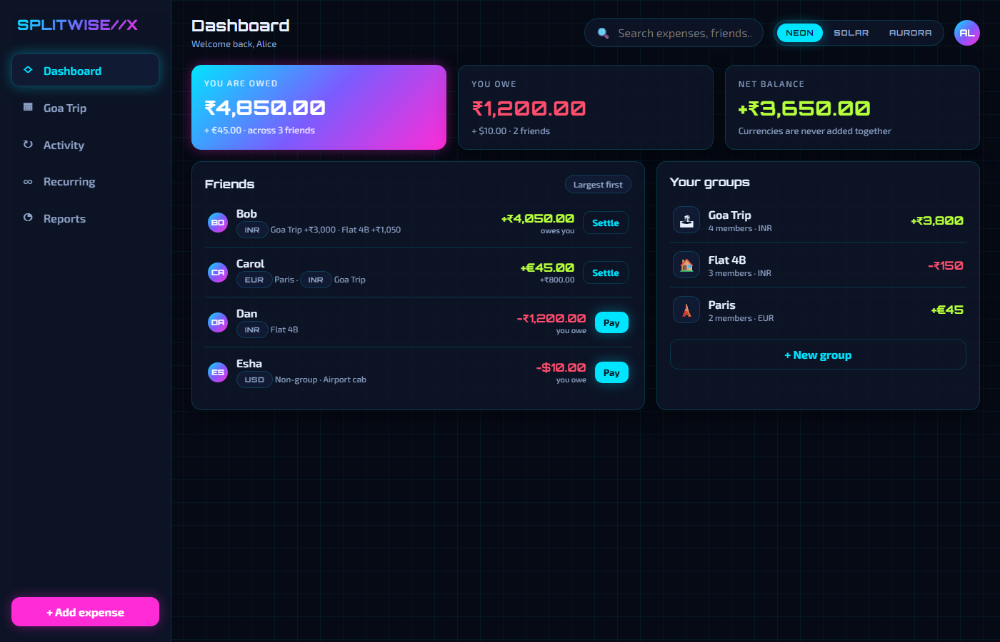
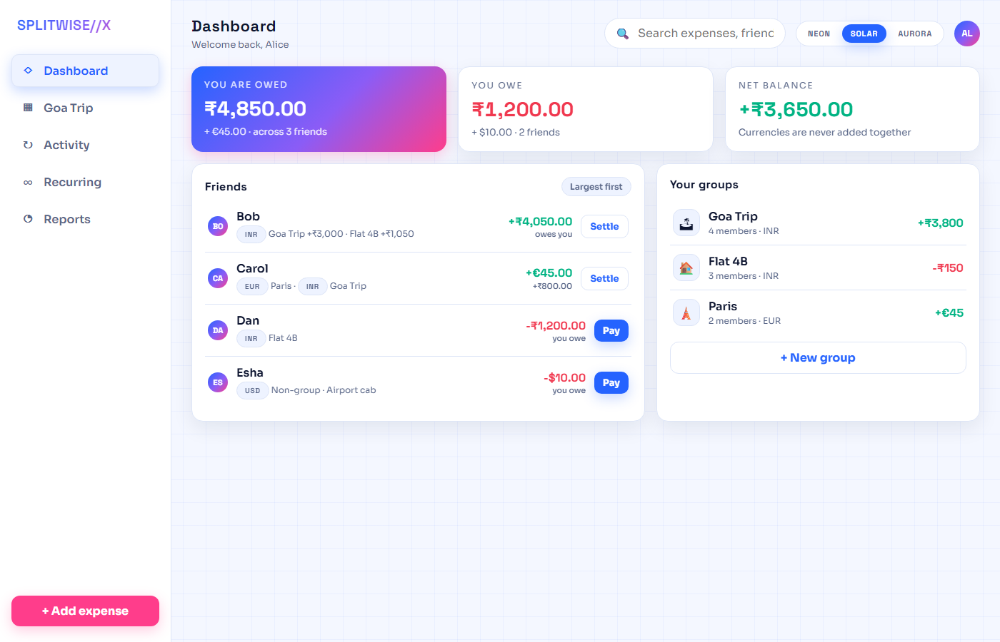
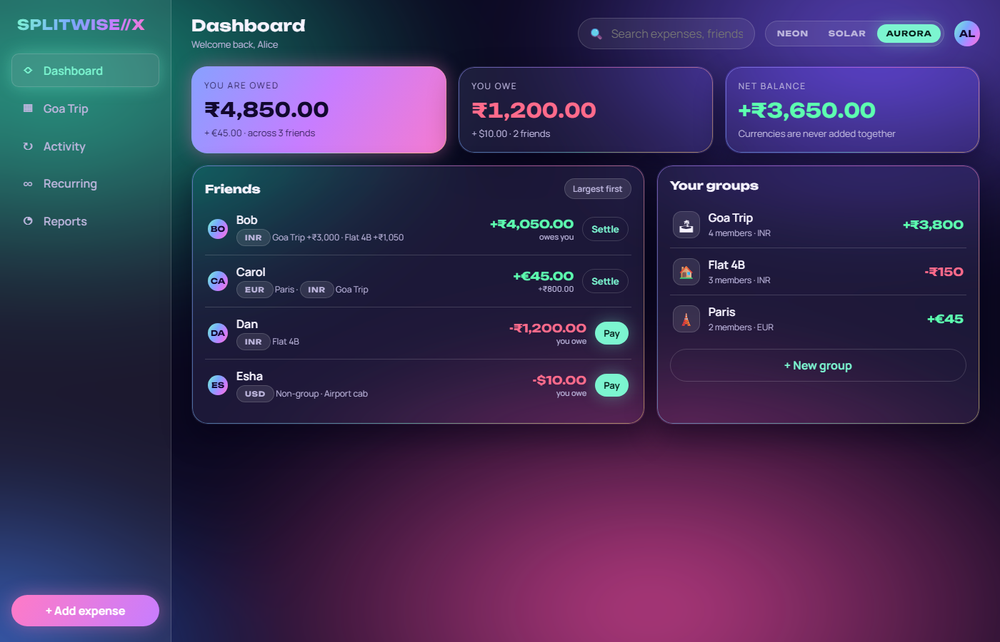
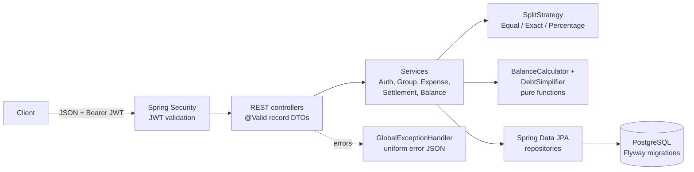

# Splitwise API

A REST API for tracking shared expenses, modelled on the core of Splitwise: users form groups, record
who paid for what, split each expense equally, by exact amounts or by percentage, see who owes whom,
and get a short list of payments that settles everyone up.

It is a backend-only portfolio project (no UI). Interaction is via JSON over HTTP, with interactive
docs in Swagger UI.

## Features

- **Accounts**: register and log in; passwords hashed with BCrypt; stateless JWT (HS256) access tokens.
  Password guessing is slowed down: after 5 wrong passwords in 15 minutes an account's sign-in is paused
  (`429` with `Retry-After`), and one address gets at most 30 sign-in/sign-up requests a minute. An unknown
  email gets the same answer as a wrong password, after the same bcrypt work, so sign-in does not reveal who
  has an account. `POST /api/auth/refresh` swaps a valid token for a fresh one in the same session, so someone
  using the app is not signed out every hour; a session cannot be renewed past `JWT_MAX_SESSION` (7 days by
  default) from sign-in, and that refusal is a `403` so the client keeps its token until it expires.
- **Your account**: change your name (`PATCH /api/users/me`) and your password (`POST /api/users/me/password`,
  which needs the current one under the same throttle as sign-in). Tokens can be revoked: each carries the
  user's token version, checked on every request, so changing the password signs out every other session at
  once (this one gets a fresh token), and `POST /api/auth/logout-all` signs out every device. A password is at
  most 72 **bytes**, not characters, since bcrypt ignores anything after them.
- **The user's own "today"**: the web app sends its time zone (`X-Time-Zone: Asia/Kolkata`), and the API uses
  it for a default date and for "a recurring expense cannot start in the past", so a user in California or
  Samoa is not told their today is in the past by a server on UTC. Without the header, the server's zone is
  used; the hourly recurring job runs on server time.
- **Groups**: create, rename, delete (creator only, and only while empty), add members by email,
  **leave or remove members** - only with a zero balance in the group, so nobody walks away owing money or
  being owed. Members can leave; only the creator removes others; the creator cannot leave.
- **Expenses**: five split strategies, all exact to the cent (done in whole cents with integer arithmetic):
  - `EQUAL`: leftover cents go one each to the lowest user ids (100.00 / 3 = 33.34 + 33.33 + 33.33).
  - `EXACT`: given amounts must add up to the expense amount exactly.
  - `PERCENTAGE`: percentages must add up to 100; rounding uses the largest-remainder method, so the
    shares always add up to the total.
  - `SHARES`: a number of shares per person (2 : 1 for a couple and a single, 1.5 allowed, 0 allowed);
    divided in proportion, same largest-remainder rounding, and a 0 share never gets a stray cent.
  - `ADJUSTMENT`: an extra amount per person (the dessert), the rest split equally:
    330 with Carol +30 = 100 / 100 / 130.
  - Each expense has a **category** (`GENERAL`, `FOOD_AND_DRINK`, `GROCERIES`, `RENT`, `UTILITIES`,
    `TRANSPORT`, `TRAVEL`, `ENTERTAINMENT`, `SHOPPING`, `HEALTH`; default `GENERAL`) and optional **notes**.
  - Expenses can belong to a group, or sit outside any group (for example, two friends sharing a cab).
    Outside groups you can only split or settle with your contacts: people you share a group with or have
    split with before. Otherwise anyone could put a debt on any account by guessing its id; a stranger and an
    id with no account get the same `403`, so ids cannot be probed. `GET /api/users/me/contacts` lists who those are, and
    `GET /api/users/me/expenses?with={id}` lists the expenses shared with one person (a friend's page).
- **Edit, delete and restore**: any group member can fix a group expense (as in Splitwise); for non-group
  expenses, anyone involved. Edits use **optimistic locking**: the client sends the `version` it read, and an
  edit based on an older version gets `409` instead of silently overwriting someone else's change. Deletes
  are soft - the expense leaves lists and balances, stays visible by id (`deleted: true`) and can be restored.
  Settlements recorded by mistake can be undone and restored the same way. Someone who has left a group can
  neither see its balances nor pay in it, so no delete, restore or re-split may change what they owe there
  (renaming or re-describing an expense they were in is fine); leaving needs a zero balance and this keeps it
  zero. Error messages name only people the caller already knows.
- **Balances**: net balance per member of a group, plus each user's overall balance.
- **Friends**: the Splitwise home screen - everyone you have an open balance with ("you owe Bob 40",
  "Carol owes you 30"), with a per-group breakdown and totals that always equal your overall balance. Group
  parts come from the group's simplified debts, the same transfers the group suggests.
- **Settle up with a friend**: one call records the payments that clear every open balance with that friend,
  one settlement per group (so each group's balances stay right) plus one for non-group expenses. Two
  simultaneous settle-ups between the same people never pay twice: both users are locked first.
- **Debt simplification**: turns a group's balances into a short list of "X pays Y amount" transfers.
- **Settle up**: record payments between users; balances and suggested transfers update immediately.
- **Activity feed**: every change is recorded in the same transaction as the change itself, so the history
  can never disagree with the data - added, edited, deleted and restored expenses and payments, members joining,
  leaving or being removed, groups created, renamed or deleted. Edits list exactly what changed
  (`Amount: 300.00 -> 400.00`, `Carol removed from the split (was 100.00)`, `Bob's share: 100.00 -> 200.00`).
  A group's feed is visible to its members; people involved in an entry keep seeing it after leaving the group;
  non-group entries are visible only to the people involved. Paginated, newest first.
- **Recurring expenses** (rent, wifi, subscriptions): weekly, monthly or yearly, with an optional end date. A
  scheduled job creates each occurrence as a real expense (hourly by default, `RECURRING_CRON`), and catches up
  runs missed while the app was down. Dates are computed from the start date, so a monthly expense starting on the
  31st falls on the 28th/29th in February and on the 31st again in March. Each occurrence is created exactly once,
  even with overlapping runs or several app instances (template and group row locks, plus a unique
  (template, date) constraint). If someone in it has left the group, the template pauses with the reason
  instead of creating an invalid expense.
- **Reports and CSV export**: per group and date range - total spent, per category, and per member (paid, own
  share, net). CSV export with one column per person (like Splitwise), properly quoted, with a UTF-8 BOM for
  Excel, and protected against CSV / formula injection (an expense called `=HYPERLINK(...)` is written as text).
- **Multiple currencies**: one currency per group (EUR for a Paris trip), any currency outside groups,
  balances and settle-ups kept per currency and never added together. Currencies without a smaller unit (JPY,
  KRW, VND...) take whole amounts only and split into whole units: 100 yen among three is 34 + 33 + 33.
- **Paged, filterable lists**: expenses by date range, category, payer and text search (with LIKE wildcards
  escaped, so the search is literal); settlements by date range. Pages load their rows' shares, payers and
  groups in batches, a fixed handful of queries per page instead of one per expense (tested).
- **Access control**: only members of a group can see or change its data (others get `403`).
- **Safe under concurrent requests**: writes that depend on group membership lock the group row first, so
  "remove a member" and "add an expense for that member" cannot interleave.
- **Consistent errors**: every error returns `{timestamp, status, error, message, path}` with an
  appropriate `400 / 401 / 403 / 404 / 409` status.

## Frontend

A React + TypeScript app in [`frontend/`](frontend/README.md), being built screen by screen. Sign-in, sign-up,
the dashboard (per-currency balances, friends, settle-up), groups (create, members) and the group page
(expenses with filters, the add/edit form with a live split preview proven against the API's own split code,
balances, payments), activity, recurring expenses and reports with CSV export are done, in three themes (Aurora is the default). The screens were designed first as a
clickable prototype in [`docs/prototype`](docs/prototype/README.md): open `docs/prototype/index.html` in a
browser, no build needed.

| Neon | Solar | Aurora |
|---|---|---|
|  |  |  |

## Tech stack

| Area | Choice |
| --- | --- |
| Language / runtime | Java 17 (builds and runs on 17+) |
| Framework | Spring Boot 3.5 (Web, Data JPA, Validation, Security, OAuth2 Resource Server for JWT) |
| Database | PostgreSQL 16, schema managed by Flyway; H2 (PostgreSQL mode) for tests |
| API docs | springdoc-openapi (Swagger UI) |
| Build / CI | Maven (wrapper included), GitHub Actions |
| Packaging | Multi-stage Dockerfile, docker compose (app + Postgres) |

Money is stored as `NUMERIC(19,2)` and handled as `BigDecimal` with scale 2 (`HALF_EVEN` where
rounding is needed). Dates use `LocalDate`, timestamps use `Instant`.

## How debt simplification works

Every expense and settlement changes each person's **net balance**:

- the payer of an expense is credited the full amount, and every participant is debited their share;
- a settlement from A to B credits A and debits B.

Positive means "is owed money", negative means "owes money", and the balances in a group always sum
to zero. Who originally paid whom no longer matters, only these net figures.

The simplifier (`DebtSimplifier`, a pure function) then works greedily:

1. Put creditors and debtors into two max-heaps, ordered by amount (ties broken by user id).
2. Take the largest creditor and the largest debtor. The debtor pays the creditor
   `min(credit, debt)`. At least one of them is now settled.
3. Put whoever still has a remaining balance back into its heap. Repeat until the heaps are empty.

Each step settles at least one person, so `n` people with non-zero balances need at most `n - 1`
transfers. Finding the true minimum number of transfers is NP-hard in general (it reduces to
partitioning people into zero-sum subsets), so this is a heuristic. It is the standard practical
approach and gives the minimum in many common cases, but not in every case.

### Worked example

Alice, Bob and Carol are on a trip:

| Expense | Paid by | Split | Alice | Bob | Carol |
| --- | --- | --- | ---: | ---: | ---: |
| Hotel 300.00 | Alice | equal | +300 - 100 | -100 | -100 |
| Dinner 60.00 | Bob | 50% Alice, 50% Carol | -30 | +60 | -30 |
| **Net** | | | **+170** | **-40** | **-130** |

Simplification: the largest debtor (Carol, 130) pays the largest creditor (Alice, 170), leaving Alice
owed 40; then Bob pays Alice 40.

```
Carol pays Alice 130.00
Bob   pays Alice  40.00
```

If Carol then records a settlement of 130 to Alice, the only remaining suggestion is
`Bob pays Alice 40.00`. This exact scenario is covered by the integration test
`ApiIntegrationTest.groupExpenseBalanceSettleFlow`.

## Architecture



Package layout (`com.splitwise`):

| Package | Responsibility |
| --- | --- |
| `web`, `web.dto`, `web.error` | Controllers, request/response records, exception-to-JSON mapping |
| `service` | Use cases, transactions and access checks |
| `split` | `SplitStrategy` interface and its three implementations |
| `balance` | `BalanceCalculator` and `DebtSimplifier` (no Spring, no I/O) |
| `domain` | JPA entities and money conventions |
| `repository` | Spring Data repositories |
| `security`, `config` | JWT issuing/validation, security filter chain, OpenAPI |

Design notes:

- Balances are **derived on read** from expenses and settlements, never stored, so they cannot drift
  out of sync. This is simple and correct; for very large groups a cached or incremental balance
  table would be the next step.
- `addExpense` runs in one transaction and checks access, split arithmetic and membership **before**
  anything is written.
- The split and simplification logic has no framework dependencies, which keeps it easy to unit-test.

## Running it

### With Docker Compose (app + PostgreSQL)

```bash
cp .env.example .env      # then set DB_PASSWORD and JWT_SECRET (at least 32 bytes)
docker compose up --build
```

The web app and the API are both on `http://localhost:8080` (the image builds the React app into the
jar), and Swagger UI is at `http://localhost:8080/swagger-ui.html`.

### Locally

You need JDK 17+ and a running PostgreSQL with an empty `splitwise` database. Flyway creates the
tables on startup.

```bash
export DB_URL=jdbc:postgresql://localhost:5432/splitwise
export DB_USERNAME=postgres
export DB_PASSWORD=your-password
export JWT_SECRET=$(openssl rand -base64 48)
./mvnw spring-boot:run
```

| Variable | Required | Default |
| --- | --- | --- |
| `DB_URL` | no | `jdbc:postgresql://localhost:5432/splitwise` |
| `DB_USERNAME` | no | `postgres` |
| `DB_PASSWORD` | yes | (none) |
| `JWT_SECRET` | yes, at least 32 bytes | (none); the app refuses to start without it |
| `JWT_EXPIRATION` | no | `PT1H` |
| `JWT_MAX_SESSION` | no | `P7D` (how long refreshing can keep one sign-in alive) |
| `RECURRING_CRON` | no | `0 5 * * * *` (hourly at minute 5) |

Behind a reverse proxy or a hosting platform's load balancer, also set
`SERVER_FORWARD_HEADERS_STRATEGY=native` (or `framework`), so the sign-in limit counts each visitor's own
address instead of the proxy's. Do not set it when clients reach the app directly: they could then fake
their address.

### The frontend

With the API running on port 8080 (Node 22.12+):

```bash
cd frontend
npm ci
npm run dev        # http://localhost:5173, /api is proxied to :8080
```

See [`frontend/README.md`](frontend/README.md) for tests and the generated API types.

### One jar for the app and the API

```bash
./mvnw -Pfrontend package              # also needs Node 22.12+; builds frontend/ into the jar
java -jar target/splitwise-api.jar      # same environment variables as above
```

Spring Boot serves the built app from the same origin as the API, so there is no CORS setup. Page
links such as `/groups/12` get the app's `index.html` and its router shows the page; hashed files
under `/assets` are cached for a year, and `index.html` is rechecked on every visit so a new release
shows up straight away. Everything under `/api` still needs a token. Without `-Pfrontend` the jar is
the API alone.

## API overview

All endpoints except register, login, the API docs and `/actuator/health` need
`Authorization: Bearer <token>`.

| Method | Path | Description |
| --- | --- | --- |
| POST | `/api/auth/register` | Create an account |
| POST | `/api/auth/login` | Get an access token |
| GET | `/api/users/me` | Current user |
| PATCH | `/api/users/me` | Change my name |
| POST | `/api/users/me/password` | Change my password; other sessions end, this one gets a fresh token |
| POST | `/api/auth/refresh` | A fresh token in the same session |
| POST | `/api/auth/logout-all` | Sign out of every device |
| GET | `/api/users/me/expenses` | Expenses I paid for or share in (paged, filterable) |
| GET | `/api/users/me/settlements` | Settlements I paid or received (paged, `from` / `to`) |
| GET | `/api/users/me/balance` | My overall net balance, one figure per currency |
| GET | `/api/users/me/friends` | Everyone I have an open balance with, per group, plus totals |
| GET | `/api/users/me/friends/{userId}` | My balance with one friend, per group |
| POST | `/api/users/me/friends/{userId}/settle-up` | Record the payments that settle everything with a friend |
| POST | `/api/groups` | Create a group (caller becomes a member; optional `currency`, default INR) |
| GET | `/api/groups` | My groups |
| GET / PUT / DELETE | `/api/groups/{id}` | Get, rename, delete a group |
| POST | `/api/groups/{id}/members` | Add a member by email |
| GET | `/api/groups/{id}/expenses` | Group expenses (paged; `from`, `to`, `category`, `paidBy`, `q`) |
| GET | `/api/groups/{id}/settlements` | Group settlements (paged, `from` / `to`) |
| GET | `/api/groups/{id}/balances` | Net balance per member |
| GET | `/api/groups/{id}/debts/simplified` | Suggested transfers to settle the group |
| POST | `/api/expenses` | Record an expense |
| GET | `/api/expenses/{id}` | One expense (also a deleted one, flagged `deleted: true`) |
| GET | `/api/expenses/{id}/activity` | The expense's history, oldest first, with every change |
| GET | `/api/groups/{id}/activity` | The group's activity, newest first (`?page=0&size=20`) |
| GET | `/api/users/me/activity` | My feed: my groups plus everything I was involved in |
| POST / GET | `/api/recurring-expenses` | Set up a recurring expense / list mine |
| GET / DELETE | `/api/recurring-expenses/{id}` | Get, or stop, a recurring expense (past expenses stay) |
| POST | `/api/recurring-expenses/{id}/resume` | Start a stopped or paused one again from its next date (missed dates are skipped) |
| GET | `/api/groups/{id}/report` | Spending summary (`?from=2026-09-01&to=2026-09-30`, both optional) |
| GET | `/api/groups/{id}/expenses.csv` | The group's expenses as a CSV download (same optional range) |
| PUT | `/api/expenses/{id}` | Edit an expense; body as for create (without `groupId`) plus `version` |
| DELETE | `/api/expenses/{id}` | Delete (soft; idempotent) |
| POST | `/api/expenses/{id}/restore` | Restore a deleted expense |
| POST | `/api/settlements` | Record a payment (settle up) |
| GET / DELETE | `/api/settlements/{id}` | Get, or undo, a settlement |
| POST | `/api/settlements/{id}/restore` | Restore an undone settlement |
| DELETE | `/api/groups/{id}/members/{userId}` | Remove a member (creator) or leave (your own id); balance must be zero |

Example session:

```bash
curl -s -X POST localhost:8080/api/auth/register -H 'Content-Type: application/json' \
  -d '{"name":"Alice","email":"alice@example.com","password":"password123"}'

TOKEN=$(curl -s -X POST localhost:8080/api/auth/login -H 'Content-Type: application/json' \
  -d '{"email":"alice@example.com","password":"password123"}' | jq -r .accessToken)

curl -s -X POST localhost:8080/api/groups -H "Authorization: Bearer $TOKEN" \
  -H 'Content-Type: application/json' -d '{"name":"Goa trip"}'

curl -s -X POST localhost:8080/api/expenses -H "Authorization: Bearer $TOKEN" \
  -H 'Content-Type: application/json' -d '{
    "description": "Dinner", "amount": 60.00, "paidById": 1, "groupId": 1,
    "splitType": "PERCENTAGE",
    "shares": [{"userId": 1, "value": 50}, {"userId": 2, "value": 50}]
  }'
```

For `EQUAL` splits the `value` of each share is ignored; for `EXACT` it is the amount owed; for
`PERCENTAGE` it is the percentage; for `SHARES` the number of shares; for `ADJUSTMENT` the extra amount on
top of an equal split (may be left out = 0). `category` and `notes` are optional.

**Currency.** A group has one currency, chosen when it is created (`{"name": "Paris", "currency": "EUR"}`,
default INR). Group expenses and payments are in that currency: leave `currency` out, or send the same code;
another code is a `400`. Outside groups any ISO 4217 code works (default INR). Balances are kept per currency
and never added together: `/users/me/balance` and the friends screen return one figure per currency, and
settling up with a friend records one payment per group plus one per currency outside groups.

**Decimals.** Amounts have at most 2 decimals. In a currency without a smaller unit (Java's
`Currency.getDefaultFractionDigits()` is 0: JPY, KRW, VND, CLP, ISK...) they must be whole numbers
(`"JPY amounts have no decimals"`), exact amounts and adjustments too, and every split part is a whole number.
The few currencies with three decimals (KWD, BHD, OMR...) stay at two: a thousandth of a dinar is too small to
matter, and amounts already saved keep their meaning.

**Dates.** Expense and payment dates must fall between 2000-01-01 and a year from the caller's today (in their
time zone, `X-Time-Zone`), which catches typos like 2099. A recurring expense starts within a year and ends at
most 50 years after its start. An expense has at most 100 people.

**Lists** (group and personal expenses, settlements) are paged and filterable:

```
GET /api/groups/{id}/expenses?page=0&size=20&from=2026-09-01&to=2026-09-30&category=GROCERIES&paidBy=2&q=pizza
-> {"content": [...], "page": 0, "size": 20, "totalElements": 57, "totalPages": 3, "last": false}
```

`size` is 1-100; `q` is a case-insensitive search in the description, taken literally (`50%` finds "50%").
Settlement lists take `from` / `to`.

Error example:

```json
{
  "timestamp": "2026-10-11T10:15:30.123Z",
  "status": 400,
  "error": "Bad Request",
  "message": "Exact shares add up to 90.00 but the expense amount is 100.00",
  "path": "/api/expenses"
}
```

## Testing

```bash
./mvnw verify
```

Tests need no database: the `test` profile runs the same Flyway migration on in-memory H2 in
PostgreSQL mode.

- **Unit tests**: each split strategy (including rounding edge cases and randomised checks that
  shares always add up to the total), `DebtSimplifier` (settled groups, chains, cycles, many users,
  at most `n - 1` transfers, determinism), `BalanceService` and JWT configuration.
- **Integration tests** (MockMvc, full Spring context): register/login, auth errors, creating
  groups and adding members, all three split types, balances, simplified debts, settlements,
  `403` for non-members, `404`, `409` and validation errors.
- **Expense life cycle** (`ExpenseLifecycleIntegrationTest`): edits change balances, shares updated in place,
  stale versions rejected, invalid edits change nothing, delete / restore and their effect on lists and
  balances, restore refused once a participant has left.
- **Membership and settlements** (`MembershipAndSettlementIntegrationTest`): leaving only at a zero balance,
  creator rules, re-adding a former member, undoing and restoring settlements, access rules.
- **Recurring expenses** (`ScheduleTest`, `RecurringExpenseIntegrationTest`): month-end and leap-day dates,
  first occurrence created immediately, monthly runs exactly once, catch-up after downtime, end dates, stopping,
  pausing when a participant leaves, validation, non-group visibility, and two simultaneous runs creating each
  occurrence once. The tests move a test clock instead of waiting. Removing the locks made the race test fail
  on the database's unique constraint - no duplicate, but a failed run. These tests also caught a real bug:
  Hibernate does not store `null` values of a collection map, so an EQUAL template lost its participants on reload.
- **Reports** (`GroupReportPropertyTest`, `ExpenseCsvTest`, `ReportIntegrationTest`): property-based checks that
  categories, payments and shares each add up to the total and nets to zero; CSV quoting, formula-injection
  defence, duplicate names; date ranges, deleted expenses excluded, the download headers.
- **Lists and currency** (`ExpenseListIntegrationTest`, `ExpenseListQueryCountTest`, `CurrencyIntegrationTest`):
  paging without overlap, every filter alone and combined, literal search, parameter validation; a page of 20
  expenses takes at most 8 SQL statements (23 without batch fetching - the test catches the N+1); group currency
  rules, invalid codes, and per-currency balances, friends and settle-up. The friend-balance property tests run
  across two currencies; mixing currencies in the calculator was caught with "user 2 owes user 1 0.01 USD
  outside any group" as the minimal example.
- **Activity** (`ExpenseDiffTest`, `ActivityFeedIntegrationTest`): each kind of change described exactly, the
  full story of a group, an expense's history after deletion, who sees what (former members, non-group,
  outsiders), failed changes leaving no trace, deleted groups, paging. Removing the "people involved" rule from
  the feed query made three of these tests fail, as it should.
- **Property-based tests for every split type** (jqwik, `SplitStrategyPropertyTest`): random totals from
  0.01 to 10,000,000.00, 1-8 people and valid values for each of the five types; checks that the parts add up
  to the total exactly, are whole cents, never negative, independent of input order, and fair (EQUAL within one
  cent of each other, PERCENTAGE / SHARES within one cent of the exact proportional value, ADJUSTMENT an equal
  split once the adjustments are removed). Checked against a deliberately wrong rounding rule: caught, with a
  zero-share participant receiving a cent as the minimal example.
- **Property-based tests** (jqwik, `FriendBalanceCalculatorPropertyTest`): thousands of random ledgers
  (up to 6 people, groups and non-group, expenses and settlements) check that friend balances add up to the
  overall balance, that A's balance with B is exactly minus B's with A, that settling every bucket leaves
  nothing, and that amounts are never zero or fractional cents. A failing case is shrunk to a minimal example.
- **Friends** (`FriendBalanceIntegrationTest`, `FriendSettleUpConcurrencyTest`): the friends screen, per-group
  breakdown, settle-up per group, deleted expenses ignored, strangers rejected, and simultaneous settle-ups
  paying only once (also without any group, where only the user lock protects; checked by removing it).
- **Concurrency** (`ConcurrentEditsIntegrationTest`): four simultaneous edits of the same version give exactly
  one success; a member leaving while an expense for them is added never ends with both succeeding. Both tests
  were checked against the code with the safeguard removed (they fail: lost updates, and a member leaving while
  owing money).

GitHub Actions runs `./mvnw -B verify` on every push to `main` and on pull requests, twice: once on H2
and once against a real PostgreSQL 16 service container.

## Roadmap

- Currency conversion (showing a total in one currency at an exchange rate)
- Password reset by email, and changing the email (both need mail sending)
- Editing a recurring template (today: stop it and create a new one)
