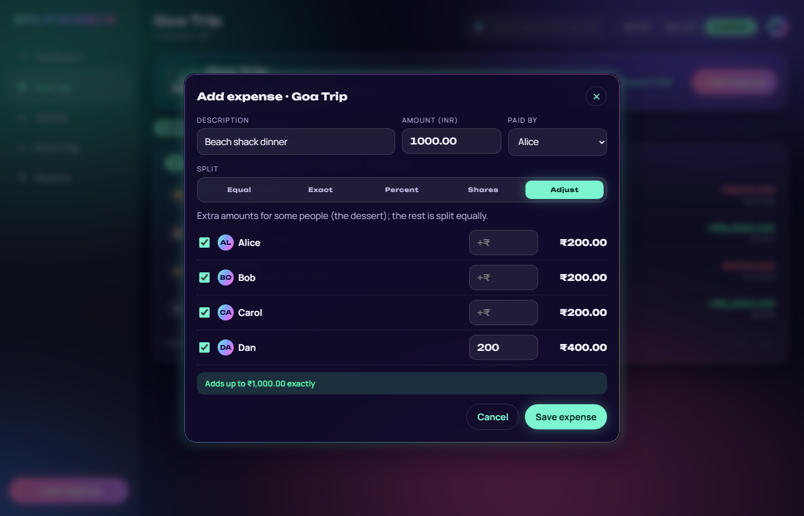
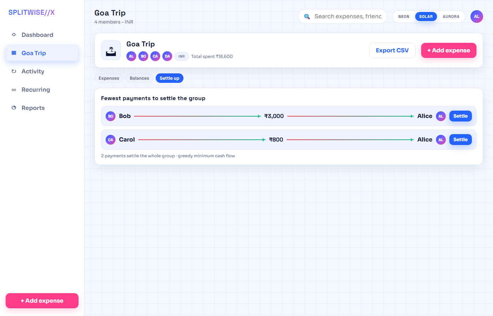

# UI prototype

A clickable, single-file prototype of the frontend, built before the real React app to settle the screens and
the look. Open `index.html` in a browser: no build, no server, demo data only.

## Themes

Switch with the NEON / SOLAR / AURORA control at the top right. The choice is remembered in the browser.

| Theme | Feel | Fonts | Colours |
|---|---|---|---|
| Neon Night | dark, grid, glow | Orbitron + Exo 2 | cyan, magenta, lime |
| Solar Day | light, crisp shadows | Space Grotesk + Sora | electric blue, hot pink, mint |
| Aurora | frosted glass over moving northern lights, iridescent card edges | Unbounded + Manrope | mint, periwinkle, violet, pink |

All three have visible keyboard focus, and every animation stops when the OS asks for reduced motion.

| Neon | Solar | Aurora |
|---|---|---|
|  |  |  |

## Screens

- **Login**
- **Dashboard**: what you are owed and what you owe, per currency (never added together); friends and groups
- **Group**: expenses with filter chips and paging, balances, and the fewest payments to settle up
- **Add expense**: all five split types (Equal, Exact, Percent, Shares, Adjust) calculate live, to the paisa,
  with the same rounding rules as the backend; the form will not save a split that does not add up
- **Activity**: what changed in each edit, and restore for deleted expenses
- **Recurring**: templates with their next date
- **Reports**: spending by category and paid / share / net per member

On a phone the sidebar becomes a bottom navigation bar.

## Deep links

Handy for screenshots: `index.html?theme=aurora&screen=group&tab=g-settle`, or
`index.html?screen=group&modal=1&split=SHARES`. Screens: `dashboard`, `group`, `activity`, `recurring`,
`reports`.
